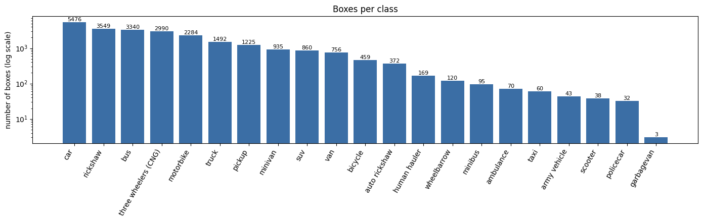
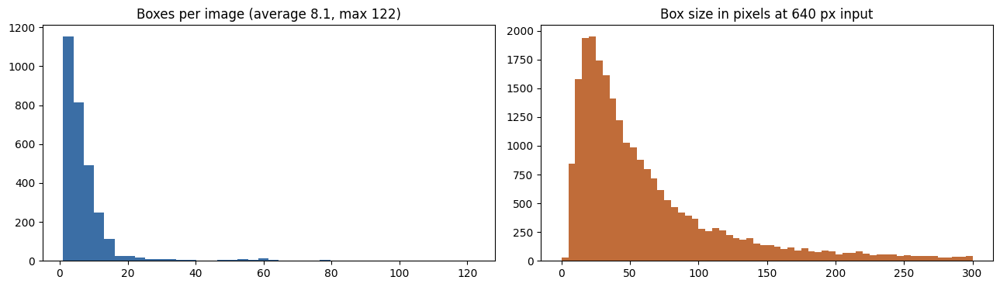
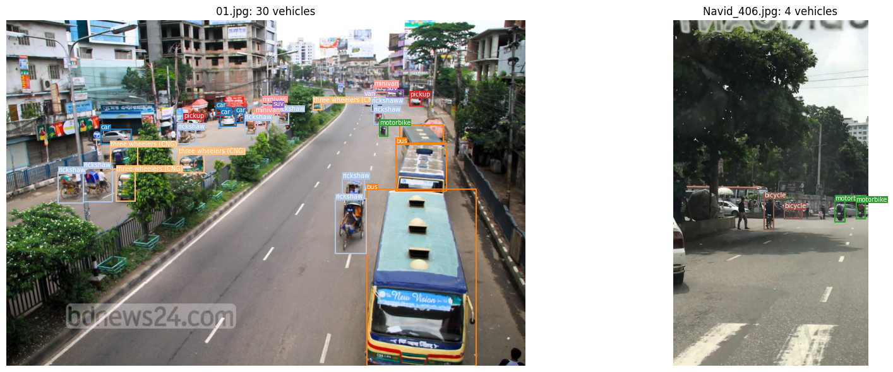
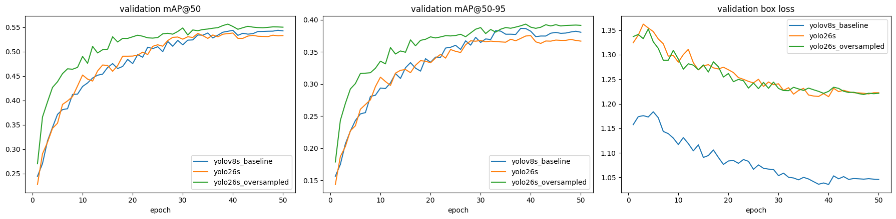
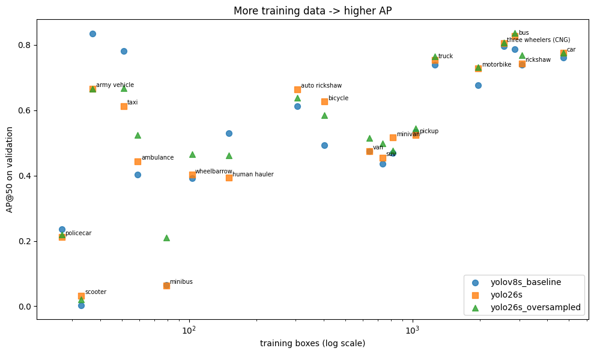
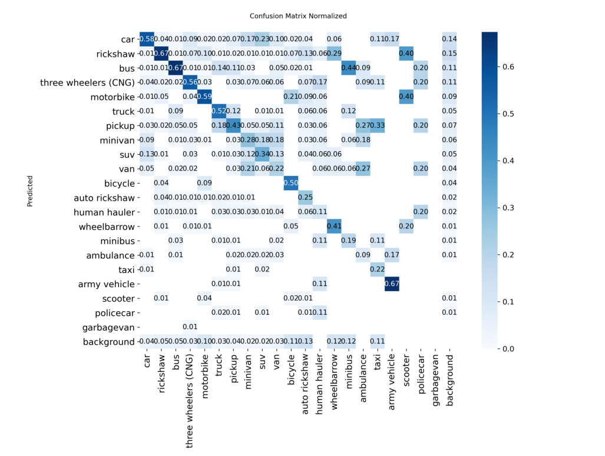
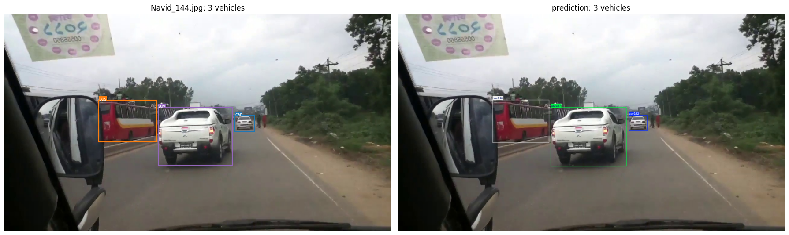
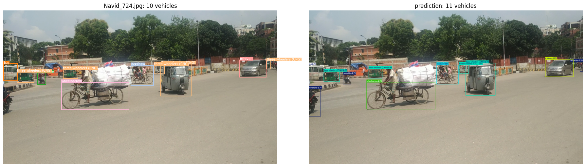
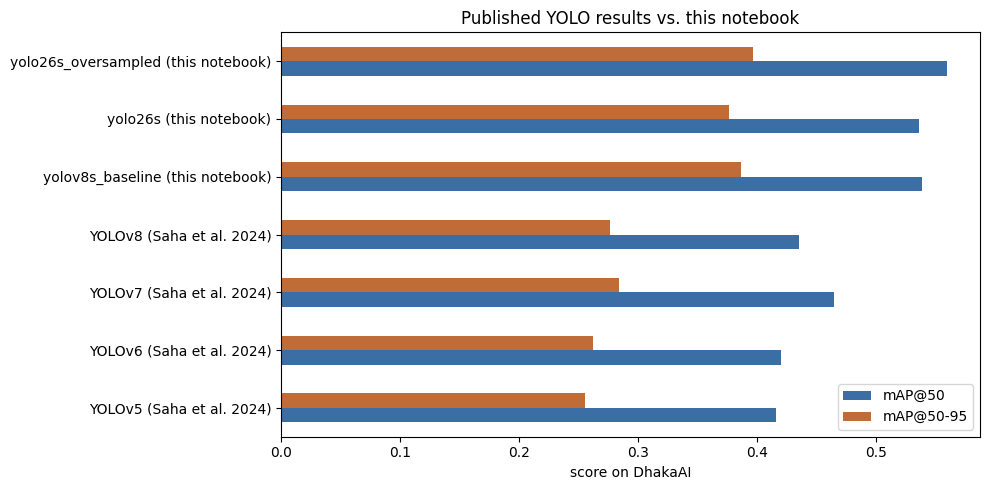

# Traffic Vehicle Detection on Dhaka-AI with YOLO26

Fine-tuning COCO-pretrained YOLO detectors for 21-class vehicle detection in dense South-Asian traffic.

## Abstract

Dhaka's streets mix cars and buses with rickshaws, CNG auto-rickshaws, human haulers, wheelbarrows and motorbikes, often dozens per image and many of them tiny. This project trains object detectors for the 21 vehicle classes of the Dhaka-AI 2020 dataset and evaluates them class by class.

Three controlled runs, all with identical data, split and hyper-parameters:

1. YOLOv8-s baseline (COCO-pretrained),
2. YOLO26-s (COCO-pretrained), a 2025 Ultralytics architecture (NMS-free, no DFL),
3. YOLO26-s with repeat-factor oversampling of images that contain rare classes.

Main findings:

1. All three fine-tuned models score about 0.10 mAP@50 higher than the published YOLOv8 result on Dhaka-AI (0.435 → 0.538–0.559).
2. YOLO26-s and YOLOv8-s are about equal under identical settings (mAP@50 0.536 vs 0.538). YOLO26-s is better on common classes and more precise, but weaker on rare ones.
3. Repeat-factor oversampling gives the best model (mAP@50 0.559, mAP@50-95 0.396) and raises rare-class AP@50 from 0.348 to 0.396 (minibus 0.06 → 0.21, ambulance 0.44 → 0.52).

| | |
|---|---|
| **Task** | Object detection, 21 vehicle classes |
| **Data** | Dhaka-AI 2020: 3,003 labelled images (1 broken file skipped), 24,368 boxes; 2,551 train / 451 validation (stratified by rarest class) |
| **Models** | YOLOv8-s and YOLO26-s, COCO-pretrained, fine-tuned |
| **Training** | 640 px, batch 16, 50 epochs, optimizer auto (AdamW), cosine LR, mosaic (off for last 10 epochs), AMP, RTX 4050 6 GB |
| **Metrics** | Precision, recall, mAP@50, mAP@50-95, per-class AP |
| **Best mAP@50 / mAP@50-95** | **0.559 / 0.396** (YOLO26-s + oversampling) |
| **Published reference** | YOLOv8 on Dhaka-AI: 0.435 / 0.276 (Saha et al. 2024) |

---

## 1. Dataset

[Dhaka-AI 2020](https://www.kaggle.com/datasets/rifat963/dhakaai-dhaka-based-traffic-detection-dataset) (also on Harvard Dataverse, doi:10.7910/DVN/POREXF) has 3,953 images. The 3,003 training images carry Pascal VOC bounding boxes; the 950 test images have no public labels, so results are reported on a held-out validation split.



The data is strongly long-tailed. `car` has 5,476 boxes, while `scooter` has 38, `policecar` 32 and `garbagevan` only 3. Scenes are crowded (8.1 boxes per image on average) and 35.7% of boxes are smaller than 32 × 32 px at 640 px input.





### Data cleaning

| Issue | Files | Fix |
|---|---|---|
| `231.xml` is not XML (it holds YOLO text with unknown class ids) | 1 | skipped |
| XML image size `0 × 0` | 2 | real image size used |
| XML size ≠ real image size (image shrunk after labelling) | 3 | coordinates normalised by the XML size |
| Boxes outside the image | few | clipped |
| Mixed formats, images up to 4096 px | all | re-saved as JPEG, longest side ≤ 1280 px |

### Split

Each image is tagged with the rarest class it contains and the 85 / 15 split is stratified on that tag (seed 42), so rare classes appear in both training and validation.

---

## 2. Method

- Conversion from Pascal VOC (`xmin, ymin, xmax, ymax` in pixels) to YOLO format (`class x_center y_center width height`, normalised to 0–1).
- Fine-tuning: start from COCO-pretrained weights (80 classes, including car, bus, truck, motorcycle and bicycle) and train a new 21-class head on Dhaka-AI.
- Repeat-factor oversampling (after Gupta et al., LVIS, CVPR 2019): a training image whose rarest class has < 100 training boxes is used 3×, < 500 boxes 2×, otherwise 1×. Training images: 2,551 → 3,430. Validation is unchanged.

| Run | Model | Training data |
|---|---|---|
| `yolov8s_baseline` | YOLOv8-s | standard |
| `yolo26s` | YOLO26-s | standard |
| `yolo26s_oversampled` | YOLO26-s | repeat-factor oversampling |



---

## 3. Results

### Overall (validation split, 451 images)

| Model | Precision | Recall | mAP@50 | mAP@50-95 | Inference (ms/img) |
|---|---:|---:|---:|---:|---:|
| YOLOv8-s baseline | 0.704 | 0.502 | 0.538 | 0.386 | 5.3 |
| YOLO26-s | **0.721** | 0.473 | 0.536 | 0.376 | 5.6 |
| **YOLO26-s + oversampling** | 0.647 | **0.542** | **0.559** | **0.396** | 5.3 |

### Rare vs. common classes (mean AP@50)

| Model | Common classes (≥ 150 train boxes) | Rare classes (< 150 train boxes) |
|---|---:|---:|
| YOLOv8-s baseline | 0.619 | 0.388 |
| YOLO26-s | 0.637 | 0.348 |
| **YOLO26-s + oversampling** | **0.646** | **0.396** |

### Per-class AP@50

| Class | Train boxes | Val boxes | YOLOv8-s | YOLO26-s | YOLO26-s + oversampling |
|---|---:|---:|---:|---:|---:|
| car | 4,729 | 747 | 0.760 | **0.775** | **0.775** |
| rickshaw | 3,077 | 472 | 0.739 | 0.743 | **0.768** |
| bus | 2,868 | 472 | 0.787 | 0.826 | **0.836** |
| three wheelers (CNG) | 2,557 | 433 | 0.795 | 0.805 | **0.806** |
| motorbike | 1,965 | 319 | 0.676 | 0.728 | **0.732** |
| truck | 1,259 | 233 | 0.739 | 0.753 | **0.764** |
| pickup | 1,033 | 192 | 0.533 | 0.524 | **0.545** |
| minivan | 816 | 119 | 0.469 | **0.516** | 0.477 |
| suv | 734 | 126 | 0.436 | 0.455 | **0.499** |
| van | 641 | 115 | 0.474 | 0.474 | **0.514** |
| bicycle | 403 | 56 | 0.493 | **0.626** | 0.584 |
| auto rickshaw | 305 | 67 | 0.612 | **0.664** | 0.638 |
| human hauler | 151 | 18 | **0.530** | 0.393 | 0.462 |
| wheelbarrow | 103 | 17 | 0.392 | 0.402 | **0.466** |
| minibus | 79 | 16 | 0.065 | 0.064 | **0.210** |
| ambulance | 59 | 11 | 0.402 | 0.444 | **0.524** |
| taxi | 51 | 9 | **0.781** | 0.613 | 0.667 |
| army vehicle | 37 | 6 | **0.835** | 0.665 | 0.665 |
| scooter | 33 | 5 | 0.002 | **0.033** | 0.022 |
| policecar | 27 | 5 | **0.236** | 0.212 | 0.219 |
| garbagevan | 3 | 0 | – | – | – |

`garbagevan` has only 3 boxes in the whole dataset (all in training), so it cannot be evaluated.



### Confusion matrix (YOLO26-s + oversampling)



### Example predictions (YOLO26-s + oversampling, left: labels, right: predictions)




### Comparison with published results

| Model | mAP@50 | mAP@50-95 |
|---|---:|---:|
| YOLOv5 (Saha et al. 2024) | 0.416 | 0.255 |
| YOLOv6 (Saha et al. 2024) | 0.420 | 0.262 |
| YOLOv7 (Saha et al. 2024) | 0.464 | 0.284 |
| YOLOv8 (Saha et al. 2024) | 0.435 | 0.276 |
| YOLOv8-s baseline (this work) | 0.538 | 0.386 |
| YOLO26-s (this work) | 0.536 | 0.376 |
| **YOLO26-s + oversampling (this work)** | **0.559** | **0.396** |

The published numbers (Saha et al. 2024, *Bangladeshi Native Vehicle Detection in Wild*, arXiv:2405.12150, Table VII) come from a different split and training setup, so this comparison is indicative; the in-notebook YOLOv8-s baseline is the controlled comparison.



---

## 4. Discussion

- Fine-tuning works with only about 2,500 training images. COCO pretraining already covers cars, buses, trucks, motorcycles and bicycles, and Ultralytics initialises the matching rows of the new 21-class head from those COCO classes.
- Under identical settings, YOLO26-s and YOLOv8-s are about equal overall. YOLO26-s is more precise (0.721 vs 0.704) and better on common classes, but weaker on rare classes. YOLO26's main changes (NMS-free end-to-end inference, no DFL, simpler export) help most with CPU and edge deployment, such as roadside cameras.
- Showing rare-class images 2–3× more often makes the model predict those classes more readily. Recall goes up from 0.47 to 0.54, precision goes down from 0.72 to 0.65, and mAP improves overall.
- Most errors are between look-alike classes: car, SUV and minivan; minivan and van; truck, pickup and bus; minibus predicted as bus. Small two-wheelers (scooter, bicycle) are often predicted as `motorbike` or missed, and 35.7% of all boxes are smaller than 32 px at 640 px input.
- `scooter` (33 training boxes, AP@50 0.02) and `policecar` (27, AP@50 0.22) remain weak, and `garbagevan` (3 boxes) cannot be evaluated. These classes need more annotation.

### Limitations

Results are on a held-out validation split, because the official test labels are not public. Rare classes have only 5–17 validation boxes, so their AP is noisy. Each model was trained once (seed 42) without hyper-parameter search.

## 5. Next steps

- Higher input resolution (960–1280 px) or tiled inference (SAHI) for the many small vehicles.
- Larger models (m / l) and longer schedules; YOLO26 in particular may need more epochs.
- Class-aware loss weighting or copy-paste augmentation for rare classes; merging classes with almost no data (`garbagevan`, 3 boxes).
- Tracking (ByteTrack) on video for vehicle counting and traffic-volume studies.

## 6. Reproducing

```bash
pip install ultralytics pandas matplotlib scikit-learn
# download the dataset and set DATASET_DIR in the configuration cell
jupyter nbconvert --to notebook --execute --inplace Dhaka_Traffic_YOLO26.ipynb
```

Everything is in one notebook: [`Dhaka_Traffic_YOLO26.ipynb`](Dhaka_Traffic_YOLO26.ipynb).
